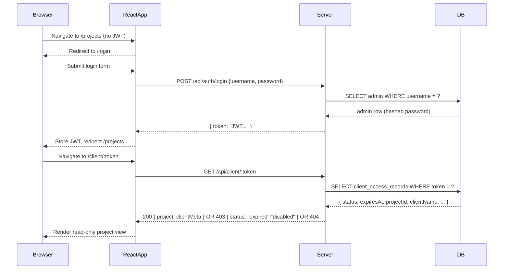
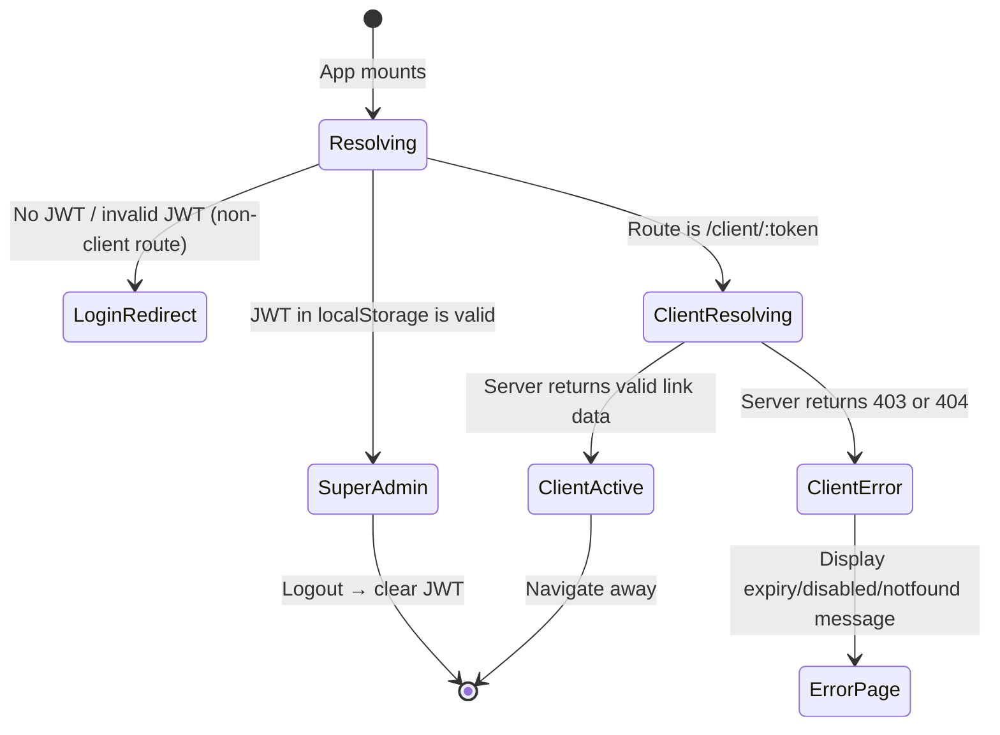

# Design Document: RBAC Client Access

## Overview

The RBAC Client Access feature adds a two-role permission layer — **Super Admin** and **Client** — to the existing Task Tracker React/Express application. No pages are duplicated; instead, a centralized Role Context gates UI elements and routes based on the current viewer's role. Super Admins authenticate with JWT (username + password). Clients access a specific project via a UUID-based shareable URL with no login, receiving a stripped-down, read-only view of the same components.

The implementation touches three layers:
1. **Backend** — new Sequelize model (`ClientAccessRecord`), new auth routes (`/api/auth`), new client-token route (`/api/client/:token`), JWT middleware on write endpoints, and rate limiting.
2. **Frontend context layer** — `RoleContext`, `usePermission` hook, `<Can>` component.
3. **Frontend UI** — wrap existing interactive elements with `<Can>`, update `Layout.jsx` for role-aware sidebar/navbar, add `Share Project` dialog, add `User Management` page, add `Login` page.

---

## Architecture

### Auth and Access Flow



### Route Architecture

```
/login                    → LoginPage (public)
/projects                 → Projects (Protected: superadmin)
/projects/upload          → UploadProject (Protected: superadmin)
/projects/:id/tasks       → ProjectTaskBoard (Protected: superadmin)
/projects/:id/dashboard   → Dashboard (Protected: superadmin)
/projects/:id/reports     → Reports (Protected: superadmin)
/developers               → Developers (Protected: superadmin)
/settings                 → Settings (Protected: superadmin)
/users                    → UserManagement (Protected: superadmin)
/client/:token            → ClientShell → resolves token → renders:
    /client/:token/tasks
    /client/:token/dashboard
    /client/:token/reports
```

### Role Context State Machine



---

## Components and Interfaces

### RoleContext (`client/src/context/RoleContext.jsx`)

```typescript
type Role = 'superadmin' | 'client';

interface ClientMeta {
  clientName: string;
  company: string | null;
  email: string | null;
  projectId: number;
  token: string;
}

interface RoleContextValue {
  role: Role;
  clientMeta: ClientMeta | null;     // Only populated when role === 'client'
  hasPermission: (permission: string) => boolean;
  loading: boolean;                  // true while token is being resolved
}
```

Implemented as a React Context with a provider `<RoleProvider>` that wraps the entire app. The provider logic:
- On mount, checks the current pathname.
- If path starts with `/client/`, extracts token, calls `GET /api/client/:token`, sets role to `client` on success.
- Otherwise, reads JWT from `localStorage`. If valid (non-expired), sets role to `superadmin`. If missing/invalid, defers — the `<ProtectedRoute>` handles the redirect.

### Permission Map

```javascript
// client/src/context/permissions.js
export const PERMISSIONS = {
  superadmin: new Set([
    'project.create', 'project.delete', 'project.share',
    'task.edit', 'task.delete', 'task.assign', 'task.status',
    'developer.manage', 'csv.upload', 'report.export',
    'settings.view', 'users.manage',
    'task.view', 'task.search', 'task.filter', 'task.sort',
  ]),
  client: new Set([
    'task.view', 'task.search', 'task.filter', 'task.sort',
    'report.export.pdf',
  ]),
};
```

### usePermission Hook (`client/src/hooks/usePermission.js`)

```javascript
// Returns true if current role has the given permission
export function usePermission(permission) {
  const { hasPermission } = useContext(RoleContext);
  return hasPermission(permission);
}
```

### Can Component (`client/src/components/Can.jsx`)

```jsx
// Renders children only when the current role holds the permission
export function Can({ permission, children, fallback = null }) {
  const allowed = usePermission(permission);
  return allowed ? children : fallback;
}
```

### ProtectedRoute Component (`client/src/components/ProtectedRoute.jsx`)

```jsx
// Redirects to /login if no valid JWT. For use on all admin routes.
export function ProtectedRoute({ children }) {
  const token = localStorage.getItem('authToken');
  if (!token || isTokenExpired(token)) {
    return <Navigate to="/login" replace />;
  }
  return children;
}
```

### ClientShell Component (`client/src/pages/ClientShell.jsx`)

Mounted at `/client/:token`. Responsibilities:
1. Calls `GET /api/client/:token` on mount.
2. While loading, renders a full-screen spinner.
3. On `403 expired` → renders `<LinkExpiredPage />`.
4. On `403 disabled` → renders `<LinkDisabledPage />`.
5. On `404` → renders `<LinkNotFoundPage />`.
6. On success → populates `RoleContext` with `role: 'client'` and `clientMeta`, then renders the project view with client-scoped sub-routes.

### ShareProjectDialog Component (`client/src/components/ShareProjectDialog.jsx`)

Props: `{ open, onClose, project }`

Internally fetches the existing `ClientAccessRecord` for the project on open. Renders:
- URL display field (read-only `TextField`)
- "Generate Secure Link" button (disabled if a link already exists and is active)
- "Copy Link" `IconButton`
- "Regenerate Link" button
- "Disable Link" / "Enable Link" toggle button
- `DatePicker` for expiry date

### UserManagement Page (`client/src/pages/UserManagement.jsx`)

Full CRUD interface for `ClientAccessRecord` entities. Uses a MUI `DataGrid` (or `Table`) with server-side data. Create form is a MUI `Dialog`.

### Updated Layout.jsx

`Layout.jsx` receives role information from `RoleContext`. The sidebar and navbar rendering switches based on role:

| Element | superadmin | client |
|---|---|---|
| Projects link | ✓ | ✗ |
| Developers link | ✓ | ✗ |
| Settings link | ✓ | ✗ |
| User Management link | ✓ | ✗ |
| Active project sub-nav (Tasks/Dashboard/Reports) | ✓ | ✓ |
| Notifications icon | ✓ | ✗ |
| User avatar / profile menu | ✓ | ✗ |
| Theme toggle | ✓ | ✗ |
| Search bar | ✓ | task-scoped only |
| Top navbar breadcrumb | project name | project + client name + company |

---

## Data Models

### ClientAccessRecord (Sequelize Model)

```javascript
// server/src/models/clientAccessRecord.js
{
  id:           INTEGER, PK, autoIncrement
  token:        STRING(36), unique, not null   // UUID v4
  projectId:    INTEGER, FK → projects.id, not null
  clientName:   STRING, not null
  company:      STRING, nullable
  email:        STRING, nullable, isEmail validated
  status:       ENUM('active', 'disabled'), default 'active'
  expiresAt:    DATE, nullable
  lastOpenedAt: DATE, nullable
  createdAt:    DATE (Sequelize auto)
  updatedAt:    DATE (Sequelize auto)
}
```

Associations:
- `ClientAccessRecord.belongsTo(Project, { foreignKey: 'projectId', onDelete: 'CASCADE' })`

### Admin Credentials (Sequelize Model)

```javascript
// server/src/models/adminCredential.js
{
  id:             INTEGER, PK, autoIncrement
  username:       STRING, unique, not null
  passwordHash:   STRING, not null   // bcrypt hash
  createdAt:      DATE
  updatedAt:      DATE
}
```

A single admin record is seeded on first startup if none exists.

### Updated Project Model

No schema changes required. The existing `clientName` field on `Project` remains for display purposes. The `ClientAccessRecord` stores the actual share-link metadata.

---

## Correctness Properties

*A property is a characteristic or behavior that should hold true across all valid executions of a system — essentially, a formal statement about what the system should do. Properties serve as the bridge between human-readable specifications and machine-verifiable correctness guarantees.*

### Property 1: Permission set disjointness for destructive actions

*For any* permission in the set `{ project.create, project.delete, task.edit, task.delete, task.assign, task.status, developer.manage, csv.upload, settings.view, users.manage }`, `hasPermission(permission)` for role `client` SHALL return `false`.

**Validates: Requirements 1.6, 1.7**

### Property 2: Permission set completeness for client read actions

*For any* permission in the set `{ task.view, task.search, task.filter, task.sort }`, `hasPermission(permission)` for role `client` SHALL return `true`.

**Validates: Requirements 1.7, 8.1–8.5**

### Property 3: Unknown permission always denied

*For any* string that is not in the defined permission sets for either role, `hasPermission(string)` SHALL return `false` for both `superadmin` and `client` roles.

**Validates: Requirements 1.8**

### Property 4: Token round-trip integrity

*For any* newly created `ClientAccessRecord`, the token stored in the database, when passed to `GET /api/client/:token`, SHALL return an HTTP 200 response containing the same `projectId` and `clientName` that were used to create the record.

**Validates: Requirements 3.1, 11.1, 11.3**

### Property 5: Expired link rejection

*For any* `ClientAccessRecord` where `expiresAt` is set to a datetime in the past, `GET /api/client/:token` SHALL return HTTP 403 with `{ "status": "expired" }`.

**Validates: Requirements 3.3, 10.5**

### Property 6: Disabled link rejection

*For any* `ClientAccessRecord` where `status` is `disabled`, `GET /api/client/:token` SHALL return HTTP 403 with `{ "status": "disabled" }`, regardless of the `expiresAt` value.

**Validates: Requirements 3.4, 10.5**

### Property 7: Token uniqueness

*For any* two distinct `ClientAccessRecord` rows, their `token` fields SHALL NOT be equal.

**Validates: Requirements 3.1, 11.2**

### Property 8: Regeneration invalidates old token

*For any* `ClientAccessRecord`, after regenerating the link, the old token SHALL return HTTP 404 or 403 and the new token SHALL return HTTP 200.

**Validates: Requirements 4.5**

### Property 9: Write endpoint authorization

*For any* HTTP request to a write-capable endpoint (POST/PUT/DELETE on `/api/projects`, `/api/tasks`, `/api/developers`) that lacks a valid JWT, the server SHALL return HTTP 401.

**Validates: Requirements 10.1, 10.2**

### Property 10: Can component renders conditionally

*For any* permission string `p` and role `r`, `<Can permission={p}>` SHALL render its children if and only if `PERMISSIONS[r].has(p)` is `true`.

**Validates: Requirements 1.5, 6.1, 6.2**

### Property 11: Cascade deletion of access records

*For any* `Project` that is deleted, all `ClientAccessRecord` rows with that `projectId` SHALL be absent from the database after deletion.

**Validates: Requirements 11.5**

### Property 12: Login rate limiting

*For any* IP address that sends more than 10 `POST /api/auth/login` requests within a 60-second window, all requests beyond the 10th SHALL receive HTTP 429.

**Validates: Requirements 10.6**

### Property 13: Invalid token format rejected before DB query

*For any* string passed as `:token` to `GET /api/client/:token` that is not a valid UUID v4, the server SHALL return HTTP 400 with `{ "error": "Invalid token format" }` without performing a database query.

**Validates: Requirements 10.4**

---

## Error Handling

### Client-Side

| Scenario | Handling |
|---|---|
| JWT missing or expired on admin route | `<ProtectedRoute>` redirects to `/login` |
| Token resolves to expired link | `<ClientShell>` renders `<LinkExpiredPage>` with message "This shared project has expired." |
| Token resolves to disabled link | `<ClientShell>` renders `<LinkDisabledPage>` with message "This project is no longer shared." |
| Token not found in DB | `<ClientShell>` renders `<LinkNotFoundPage>` with message "Link not found." |
| API error during token resolution | `<ClientShell>` renders a generic error state |
| Clipboard API unavailable | Copy Link falls back to `document.execCommand('copy')` with a toast fallback message |

### Server-Side

| Scenario | HTTP Status | Response Body |
|---|---|---|
| Login with wrong credentials | 401 | `{ "error": "Invalid credentials" }` |
| Missing/invalid JWT on write endpoint | 401 | `{ "error": "Unauthorized" }` |
| Valid JWT but insufficient role (future) | 403 | `{ "error": "Forbidden" }` |
| Token not found | 404 | `{ "error": "Link not found" }` |
| Token found, link expired | 403 | `{ "status": "expired", "error": "Link has expired" }` |
| Token found, link disabled | 403 | `{ "status": "disabled", "error": "Link is disabled" }` |
| Invalid UUID format for token | 400 | `{ "error": "Invalid token format" }` |
| Rate limit exceeded | 429 | `{ "error": "Too many requests" }` |
| Unhandled server error | 500 | `{ "error": "Internal server error" }` |

---

## Testing Strategy

### Dual Testing Approach

Both unit tests and property-based tests are required. They are complementary:
- **Unit tests** validate specific examples, integration points, and error conditions.
- **Property-based tests** verify universal correctness guarantees across randomly generated inputs.

### Property-Based Testing

Library: **fast-check** (JavaScript/TypeScript, works with Vitest).

Configuration: minimum 100 iterations per property test.

Each property test is tagged with the format:
`Feature: rbac-client-access, Property {N}: {property_text}`

| Property | Test Description | fast-check Arbitraries |
|---|---|---|
| P1 | hasPermission returns false for all destructive perms when role=client | `fc.constantFrom(...destructivePerms)` |
| P2 | hasPermission returns true for all read perms when role=client | `fc.constantFrom(...readPerms)` |
| P3 | Unknown permissions always return false | `fc.string()` filtered to exclude known permissions |
| P4 | Token round-trip: create record → GET /api/client/:token → same projectId/clientName | `fc.record({ clientName: fc.string(), projectId: fc.integer() })` |
| P5 | Expired link always returns 403 expired | `fc.date()` filtered to past dates |
| P6 | Disabled link always returns 403 disabled | `fc.record(...)` with status=disabled |
| P7 | Token uniqueness across N generated records | `fc.array(fc.record(...), { minLength: 2 })` |
| P8 | Regeneration: old token 404, new token 200 | single record, regenerate, check both tokens |
| P9 | Write endpoints reject requests without JWT | `fc.constantFrom(...writeEndpoints)` |
| P10 | Can component renders iff permission is held | `fc.constantFrom(...allPermissions)` × `fc.constantFrom('superadmin','client')` |
| P11 | Cascade delete removes all access records | `fc.array(fc.record(...), { minLength: 1 })` |
| P12 | Rate limiting triggers after 10 login requests/min | sequential request loop |
| P13 | Non-UUID-v4 token strings return 400 without DB query | `fc.string()` filtered to exclude valid UUID v4 format |

### Unit Tests

Library: **Vitest** + **@testing-library/react** (already standard for Vite projects).

Key unit test areas:
- `LoginPage` renders form and handles submit/error states
- `ProtectedRoute` redirects when no JWT present
- `ClientShell` renders error pages for expired/disabled/notfound states
- `ShareProjectDialog` opens, generates link, copy button triggers clipboard
- `UserManagement` table renders rows, delete confirmation dialog
- `TaskDetailsDrawer` in read-only mode hides all editable fields
- `Layout` sidebar renders correct items per role
- Server `authMiddleware` validates and rejects tokens correctly
- Server `clientAccessController` create/read/update/delete operations

### Integration Points

- `GET /api/client/:token` end-to-end: create record in DB, fetch via endpoint, validate response shape.
- JWT flow: login → receive token → use token on protected endpoint → logout → verify protected endpoint returns 401.
